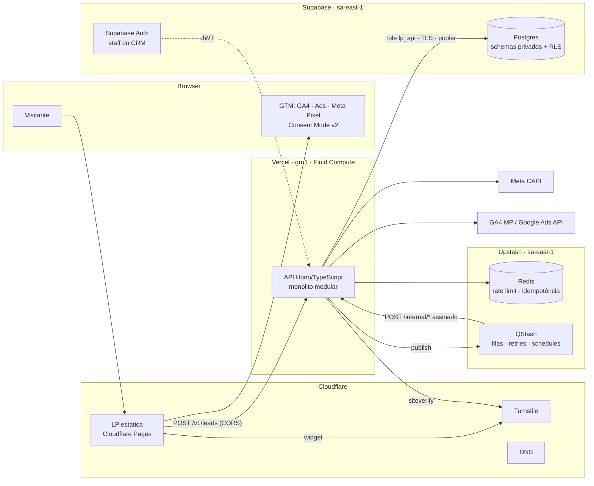

# Spec 000 — Visão geral do sistema: LP + CRM Inteligente

> Status: **draft v0.1** · Data: 2026-11-03 · Dono: Bruno Bracaioli
> Esta é a spec-mãe. Specs de feature: [lead-capture](lead-capture.md) ·
> [crm](crm.md) · [tracking](tracking.md) · [database](database.md).
> Plano de execução: [implementation-waves](../plan/implementation-waves.md).

## 1. Objetivo

Captar leads B2B por uma landing page de alta conversão, com **traqueamento
avançado** (GTM, GA4, Google Ads, Meta Pixel + Conversions API com deduplicação)
e entregar cada lead a um **CRM inteligente** que deduplica, pontua, organiza em
pipeline e — em waves posteriores — qualifica com IA e devolve sinais de
qualidade (offline conversions) para as plataformas de anúncio.

### Métricas de sucesso

| Métrica | Alvo v1 |
|---|---|
| Leads perdidos por falha de backend | 0 (todo 202 está persistido) |
| p95 de `POST /v1/leads` (região gru1) | ≤ 800 ms (inclui Turnstile) |
| Taxa de match Pixel × CAPI (dedup por `event_id`) | ≥ 90% dos `Lead` com consentimento |
| Submissões de bot persistidas | < 1% (Turnstile + honeypot + rate limit) |
| Vazamento de PII em logs | 0 ocorrências (redaction testada) |

### Fora de escopo (v1)

- Envio automático de mensagens ao lead (WhatsApp/e-mail) — só com consentimento e
  aprovação humana, em wave futura.
- Multi-empresa comercial (SaaS). O modelo é *multi-tenant ready* (ver ADR-0006),
  mas opera com um único workspace.
- Enriquecimento por scraping do site da empresa (exigiria proteção SSRF completa).

## 2. Contexto e atores

| Ator | Descrição | Canal |
|---|---|---|
| Visitante | Pessoa anônima na LP; vira *lead* ao enviar o formulário | Browser → LP (Cloudflare Pages) → API |
| Vendedor (sales) | Trabalha o pipeline no CRM | CRM web → API (Supabase Auth) — wave 9+ |
| Admin | Configura workspace, exporta, atende titular (LGPD) | CRM web → API (MFA obrigatório) |
| QStash | Worker assíncrono (Upstash) que chama endpoints internos | HTTPS assinado (JWT `Upstash-Signature`) |
| Plataformas de ads | Meta (Pixel/CAPI), Google (GA4, Ads) | Browser (tags) e server-to-server |
| LLM (Claude) | Qualificação e resumo do lead — wave 11 | Server-to-server; saída é dado não confiável |

## 3. Arquitetura



### Decisões estruturais (ADRs)

| ADR | Decisão |
|---|---|
| [0001](../adr/0001-modular-monolith-typescript-hono-vercel.md) | Monolito modular + VSA em TypeScript (Hono) na Vercel |
| [0002](../adr/0002-hosting-split-cloudflare-pages-vercel-api.md) | LP no Cloudflare Pages, API na Vercel em `api.<domínio>`, Turnstile anti-bot |
| [0003](../adr/0003-database-access-dedicated-role-private-schemas.md) | Acesso ao Postgres por role dedicada, schemas privados, RLS deny-by-default, sem Data API |
| [0004](../adr/0004-transactional-outbox-qstash.md) | Transactional outbox no Postgres + QStash para integrações externas |
| [0005](../adr/0005-public-lead-endpoint-compensating-controls.md) | `POST /v1/leads` é exceção pública explícita, com controles compensatórios |
| [0006](../adr/0006-multi-tenant-ready-single-workspace.md) | Modelo *multi-tenant ready* (`workspace_id` + RLS), operando 1 workspace |
| [0007](../adr/0007-api-toolchain-and-module-boundaries.md) | Alias `#/`, TS 6, boundaries por lint, build esbuild, supply chain do pnpm |

### Bounded contexts (módulos)

| Módulo | Responsabilidade | Linguagem ubíqua | Interface pública |
|---|---|---|---|
| `platform` (shared kernel) | Config, logger, correlation ID, erros RFC 9457, headers, métricas, DB/Redis clients | — | utilitários técnicos (sem regra de negócio) |
| `lead-capture` | Receber, proteger, validar e registrar submissões do formulário | *Submissão*, *Formulário*, *Consentimento*, *Prova humana* | `SubmitLead` (HTTP) |
| `crm` | Lead (agregado), dedupe, pipeline, score, atividades, dono, LGPD do titular | *Lead*, *Estágio*, *Score*, *Atividade*, *Dono* | `RegisterInboundLead`, `ChangeStage`, consultas |
| `tracking` | Atribuição (UTMs, click IDs), outbox, despacho de conversões (CAPI, GA4, Ads) | *Evento de conversão*, *Entrega*, *Destino*, *Toque* | consumidor do outbox (`DispatchOutboxEvent`) |
| `intelligence` (wave 11) | Qualificação por IA, insights, automações de SLA | *Insight*, *Qualificação* | consumidor do outbox |

Regra: módulos se comunicam **apenas** por `modules/<ctx>/public-api.ts` ou por
eventos do outbox. `lead-capture` chama `crm.RegisterInboundLead` dentro da mesma
unidade de trabalho (transação) — ver ADR-0001.

### Estrutura de pastas alvo

```
.
├── apps/
│   ├── api/                       # Vercel project (wave 0–6, 9, 11)
│   │   └── src/
│   │       ├── index.ts           # composition root: Hono app + middlewares + rotas
│   │       ├── platform/          # config, logger, correlation, errors, http-security, db, redis, metrics
│   │       └── modules/
│   │           ├── lead-capture/{domain,application,infrastructure,presentation}/
│   │           ├── crm/{domain,application,infrastructure,presentation}/  + public-api.ts
│   │           └── tracking/{domain,application,infrastructure,presentation}/
│   ├── lp/                        # Cloudflare Pages (wave 7 — Codex)
│   └── crm-web/                   # CRM UI (wave 10 — Codex)
├── contracts/openapi.v1.yaml      # contrato API-first (fonte da verdade)
├── supabase/                      # config.toml, migrations/, tests/ (pgTAP), seed.sql
├── docs/{specs,adr,plan,security/threats,how-to,reference,explanation,tutorials}/
└── .github/workflows/             # CI (actions pinadas por SHA)
```

## 4. Stack

| Camada | Escolha | Observações |
|---|---|---|
| Linguagem | TypeScript (strict, `erasableSyntaxOnly: true`) | Compatível com *type stripping* nativo do Node (scripts locais rodam com `node x.ts`) |
| Runtime | Node.js 24 LTS · Vercel Functions (Fluid Compute) · região `gru1` | `maxDuration` 10 s em rotas públicas |
| HTTP | Hono | Middlewares: request-id, secure headers, CORS, body limit |
| Validação | Zod 4 | Schemas `.strict()` em toda fronteira (HTTP, QStash, respostas de terceiros, LLM) |
| DB | Supabase Postgres 17 · driver `postgres` (porsager) via Supavisor (transaction mode, `prepare: false`) | Só queries parametrizadas (tagged templates). Sem ORM. |
| Cache / limites | Upstash Redis + `@upstash/ratelimit` | Rate limit, idempotência, contadores de custo |
| Filas | Upstash QStash | Entrega com retry/backoff, schedules (sweeper) |
| Anti-bot | Cloudflare Turnstile (managed) | Validação server-side obrigatória |
| Auth staff | Supabase Auth (JWT assimétrico, JWKS) + MFA para admin | Wave 9 |
| Telefones | `libphonenumber-js` (metadata `max`) | Normalização E.164 |
| Logs | `pino` JSON com redaction | Sem `console.log` |
| Traces/métricas | `@vercel/otel` (OpenTelemetry) + `metric()` de `@vercel/functions` | |
| Testes | Vitest, fast-check, MSW, pgTAP (`supabase test db`), k6, OWASP ZAP baseline | |
| CI | GitHub Actions (SHA-pinned): lint, typecheck, test, build, gitleaks, osv-scanner, Semgrep, Redocly lint | |

## 5. Requisitos não funcionais

### 5.1 Segurança (baseline transversal)

- **Deny by default**: toda rota exige auth; exceções públicas (`POST /v1/leads`,
  `GET /v1/health`) declaradas no OpenAPI com `security: []` e justificadas no ADR-0005.
- **Ordem fixa por request**: guards de transporte → rate limit por IP → prova humana
  (Turnstile) / autenticação → autorização → validação completa → lógica de negócio.
- **Injeção (SQLi etc.)**: só queries parametrizadas; zero SQL dinâmico; role de banco
  com privilégio mínimo; RLS como segunda barreira; CHECK constraints no banco como
  terceira. Detalhe por campo em [lead-capture §4](lead-capture.md#4-campos-e-regras-de-validação).
- **Headers em todas as respostas** (inclusive erros e 204 de preflight):
  `Strict-Transport-Security: max-age=63072000; includeSubDomains; preload`,
  `Content-Security-Policy: default-src 'none'; frame-ancestors 'none'`,
  `X-Content-Type-Options: nosniff`, `X-Frame-Options: DENY`,
  `Referrer-Policy: no-referrer`, `Permissions-Policy: ()` mínima,
  `Cross-Origin-Resource-Policy: same-site`, `Cache-Control: no-store`.
- **Erros** no formato RFC 9457 (`application/problem+json`) com `code` estável e
  `correlation_id`. Nunca stack trace, mensagem de driver, nome de tabela ou detalhe
  de qual barreira barrou.
- **Segredos** só em env vars da Vercel / `.env.local` (gitignored). gitleaks em
  pre-commit e no CI.
- Mapeamento completo para OWASP Top 10:2025 e OWASP API Top 10:2023 em
  [lead-capture §8](lead-capture.md#8-mapeamento-owasp) e no
  [threat model](../security/threats/backend-v1.md).

### 5.2 Privacidade (LGPD)

| Item | Definição v1 |
|---|---|
| Papel | Empresa dona da LP = **controladora**; Supabase, Vercel, Upstash, Cloudflare, Meta, Google = operadores/terceiros |
| Base legal — contato comercial | Consentimento (checkbox obrigatório da Política de Privacidade) + legítimo interesse para retorno ao pedido |
| Base legal — marketing | Consentimento opcional (`marketing_opt_in`) |
| Base legal — ads (CAPI/Enhanced Conversions) | Consentimento do banner (Consent Mode v2: `ad_user_data` = `granted`) |
| Minimização | IP e User-Agent brutos só para antifraude/CAPI; expurgados em 30 dias (ficando só HMAC do IP) |
| Retenção | Ver [database §6](database.md#6-retenção-e-expurgo) |
| Direitos do titular | Exportação e anonimização por admin (wave 9), sem quebrar integridade referencial |
| Terceiros | PII enviada a Meta/Google só normalizada + SHA-256, server-side |
| Registro de consentimento | Append-only (`capture.consents`) com versão da política |

### 5.3 Observabilidade

- Logs JSON com `correlation_id`, `module`, `route`, `outcome`, `duration_ms`, IDs internos
  (`lead_id`, `submission_id`) — **nunca** nome, e-mail, WhatsApp, IP, token.
- `X-Request-Id` aceito do cliente se for UUID válido, senão gerado; propagado ao QStash
  (header `Upstash-Forward-X-Request-Id`) e às chamadas de terceiros quando suportado.
- Métricas: `lead_capture.requests{outcome}`, `lead_capture.latency_ms`,
  `antibot.failures`, `ratelimit.blocked{scope}`, `outbox.lag_s`,
  `delivery.result{destination,status}`, `ai.cost_usd` (wave 11).
- Audit log estruturado (`core.audit_log`) para: lead criado/atualizado, mudança de
  estágio/dono, exportação, anonimização, login staff (wave 9).

### 5.4 Disponibilidade e desempenho

- Um lead que recebeu `202` **está commitado no Postgres**. Integrações externas nunca
  bloqueiam a resposta (outbox).
- Timeouts de saída: Turnstile 3 s · Redis 1 s · Postgres `statement_timeout` 3 s ·
  Meta/GA4 5 s · LLM 20 s.
- Degradação: Redis fora → rate limit **fail-open** com alerta (Turnstile continua
  obrigatório); Turnstile fora → **fail-closed** (`503` + `Retry-After`), o front oferece
  nova tentativa; QStash fora → sweeper reenfileira.

## 6. Contrato de configuração (env vars)

Validado por Zod no boot (`platform/config`); app não sobe se faltar variável obrigatória
do ambiente. Referência viva e template: [docs/reference/environment.md](../reference/environment.md).

| Variável | Wave | Segredo | Uso |
|---|---|---|---|
| `APP_ENV` | 0 | não | `development` \| `preview` \| `production` |
| `LOG_LEVEL` | 0 | não | `info` default |
| `CORS_ALLOWED_ORIGINS` | 0 | não | Lista separada por vírgula (ex.: `https://www.dominio.com.br`) |
| `DATABASE_URL` | 1 | **sim** | Pooler Supavisor, porta 6543, usuário `lp_api.<project_ref>`, `sslmode=verify-full` |
| `DATABASE_CA_CERT` | 1 | não | PEM (base64) do CA do Supabase |
| `SUPABASE_URL` | 1 | não | URL do projeto (Auth/JWKS na wave 9) |
| `SUPABASE_PROJECT_REF` | 1 | não | CLI / migrations |
| `SUPABASE_ACCESS_TOKEN`, `SUPABASE_DB_PASSWORD` | 1 | **sim** | **Apenas** CLI local/CI para migrations; nunca no runtime da API |
| `UPSTASH_REDIS_REST_URL`, `UPSTASH_REDIS_REST_TOKEN` | 3 | **sim** | Rate limit e idempotência |
| `TURNSTILE_SECRET_KEY` | 3 | **sim** | siteverify |
| `TURNSTILE_SITE_KEY` | 7 | não (público) | Widget no front |
| `HASH_PEPPER` | 3 | **sim** | HMAC-SHA256 de IP/e-mail para rate limit e analytics (`openssl rand -base64 32`) |
| `QSTASH_URL`, `QSTASH_TOKEN` | 5 | **sim** | Publicar mensagens |
| `QSTASH_CURRENT_SIGNING_KEY`, `QSTASH_NEXT_SIGNING_KEY` | 5 | **sim** | Verificar assinatura nos endpoints internos |
| `PUBLIC_API_BASE_URL` | 5 | não | URL pública da API (destino dos callbacks do QStash) |
| `META_PIXEL_ID` | 5 | não | |
| `META_CAPI_ACCESS_TOKEN` | 5 | **sim** | System User token com escopo mínimo |
| `META_GRAPH_API_VERSION` | 5 | não | Pinada (ex.: `v25.0`) |
| `META_TEST_EVENT_CODE` | 5 | não | Só em `development`/`preview` |
| `GA4_MEASUREMENT_ID`, `GA4_API_SECRET` | 5 | `GA4_API_SECRET` **sim** | Measurement Protocol (opcional) |
| `SUPABASE_JWT_ISSUER`, `SUPABASE_JWKS_URL` | 9 | não | Verificação do JWT do staff |
| `AI_GATEWAY_API_KEY` ou `ANTHROPIC_API_KEY` | 11 | **sim** | Qualificação por IA |

## 7. Questões em aberto

| # | Pergunta | Default adotado até resposta |
|---|---|---|
| Q1 | "Área de atuação" é o **segmento da empresa** ou a **área profissional** da pessoa? | Segmento da empresa (enum em [lead-capture §4.2](lead-capture.md#42-enum-area_of_expertise)); cargo vai em `job_title` |
| Q2 | Qual o ICP (perfil ideal) para o score v1? | Pesos placeholder em [crm §5](crm.md#5-score-v1-regras-determinísticas), configuráveis por workspace |
| Q3 | Bloquear e-mails descartáveis / exigir e-mail corporativo? | Aceitar gmail/hotmail (só reduz score); bloquear lista de descartáveis |
| Q4 | Domínio final da LP e da API | `www.<dominio>` (Pages) e `api.<dominio>` (Vercel, DNS-only) |
| Q5 | Retenção de leads sem conversão | Anonimizar após 24 meses sem atividade |
| Q6 | Plano Vercel (Hobby/Pro) | Pro presumido (Firewall custom rules, sem limite de cron — usamos QStash de qualquer forma) |
| Q7 | Supabase CLI no CI usa token estático (sem OIDC disponível) | Exceção documentada: token de escopo mínimo em GitHub Environment protegido, rotação trimestral |
