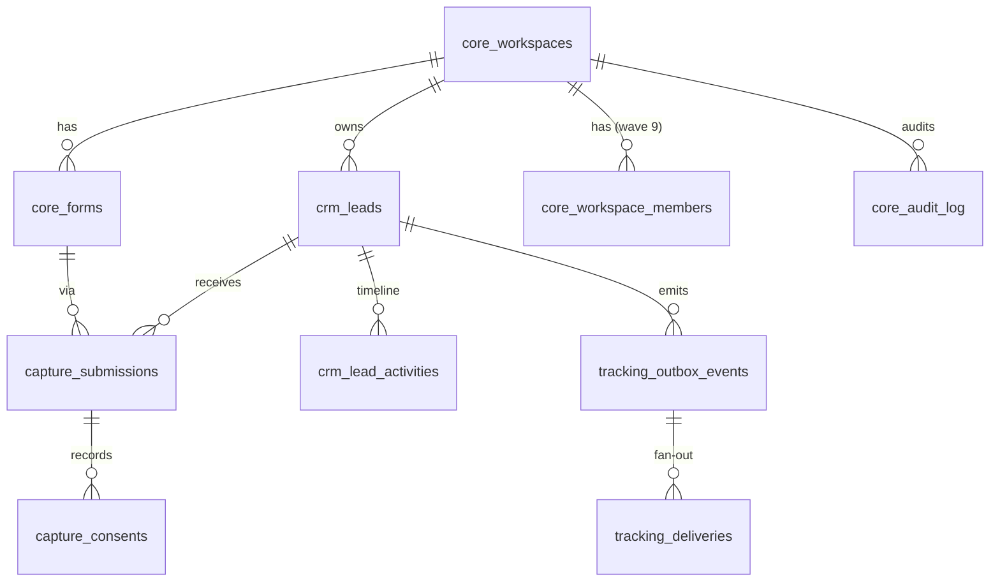

# Spec — Banco de dados (Supabase Postgres)

> Status: **draft v0.2** · Waves: 1 (schema núcleo), 6b (retenção e anonimização), 9 (membros/staff)
> ADRs: [0003](../adr/0003-database-access-dedicated-role-private-schemas.md),
> [0006](../adr/0006-multi-tenant-ready-single-workspace.md)

## 1. Princípios

- **Schemas privados por bounded context**: `core`, `crm`, `capture`, `tracking`.
  Nenhum deles é exposto pela Data API (PostgREST) — `supabase/config.toml`
  `[api] schemas = ["public"]` e `public` fica vazio. `anon` e `authenticated` não têm
  `USAGE` nesses schemas.
- **Runtime acessa só via role `lp_api`** (LOGIN, sem `BYPASSRLS`, sem DDL, sem `DELETE`).
  A senha é definida **fora** das migrations (how-to `docs/how-to/rotate-db-role-password.md`, wave 1).
- **RLS habilitada e forçada** (`ENABLE` + `FORCE ROW LEVEL SECURITY`) em todas as tabelas.
  Política padrão do `lp_api`: `workspace_id = current_setting('app.workspace_id', true)::uuid`.
  A aplicação executa `SELECT set_config('app.workspace_id', $1, true)` no início de cada
  transação (escopo da transação — seguro com pooler em transaction mode).
- **Defesa em profundidade**: CHECK constraints espelham os limites da spec de lead-capture.
- **IDs**: UUID v7 gerados na aplicação (o domínio cria a identidade do agregado).
- **Enums como `text` + `CHECK`** (evoluem com migration simples; o domínio é a fonte da regra).
- **Migrations imutáveis**, SQL com keywords em UPPERCASE, sem `SELECT *`, índices comentados.
- **Timestamps** `timestamptz` em UTC; `updated_at` mantido por trigger.

## 2. Diagrama



## 3. Tabelas

> Tipos e constraints abaixo são o contrato da migration da wave 1.

### 3.1 `core.workspaces`

| Coluna | Tipo | Regras |
|---|---|---|
| `id` | `uuid` PK | |
| `slug` | `text` | `UNIQUE`, `CHECK (slug ~ '^[a-z0-9-]{3,40}$')` |
| `name` | `text` | `CHECK (char_length(name) BETWEEN 1 AND 120)` |
| `settings` | `jsonb` | default `'{}'`; ICP/pesos do score (validado por Zod na app) |
| `created_at`, `updated_at` | `timestamptz` | default `now()` |

### 3.2 `core.forms`

| Coluna | Tipo | Regras |
|---|---|---|
| `id` | `uuid` PK | |
| `workspace_id` | `uuid` FK → workspaces | `NOT NULL` |
| `form_key` | `text` | `UNIQUE`, `CHECK (form_key ~ '^frm_[a-z0-9_]{3,40}$')` — identificador **público** |
| `name` | `text` | 1–120 |
| `status` | `text` | `CHECK (status IN ('active','paused','archived'))` |
| `allowed_origins` | `text[]` | `NOT NULL`, cada item `^https://[a-z0-9.-]+(:[0-9]+)?$` (validado por trigger/CHECK em função) |
| `turnstile_action` | `text` | default `'lead_submit'`, `^[a-z0-9_]{1,32}$` |
| `privacy_policy_version` | `text` | `^[0-9]{4}-[0-9]{2}-[0-9]{2}(\.[0-9]+)?$` (ex.: `2026-11-03`) |
| `created_at`, `updated_at` | `timestamptz` | |

### 3.3 `crm.leads` (agregado Lead)

| Coluna | Tipo | Regras |
|---|---|---|
| `id` | `uuid` PK | |
| `workspace_id` | `uuid` FK | `NOT NULL` |
| `first_name` | `text` | 1–60 |
| `last_name` | `text` | 1–80 |
| `email` | `text` | ≤ 254, `CHECK (email = lower(email))`, `CHECK (email ~ '^[^@\s]+@[^@\s]+\.[^@\s]+$')` |
| `whatsapp_e164` | `text` | `CHECK (whatsapp_e164 ~ '^\+[1-9][0-9]{7,14}$')` |
| `company_name` | `text` | 2–120 |
| `area_of_expertise` | `text` | `CHECK (… IN (<enum de lead-capture §4.2>))` |
| `area_of_expertise_other` | `text` NULL | 2–80; `CHECK ((area_of_expertise = 'other') = (area_of_expertise_other IS NOT NULL))` |
| `job_title` | `text` NULL | 2–100 |
| `company_size` | `text` NULL | enum |
| `company_website` | `text` NULL | ≤ 200, `^https?://` |
| `stage` | `text` | default `'new'`, `CHECK (stage IN ('new','contacted','qualified','proposal','won','lost'))` |
| `lost_reason` | `text` NULL | `CHECK ((stage = 'lost') = (lost_reason IS NOT NULL))`, enum de [crm §4](crm.md#4-pipeline-máquina-de-estados) |
| `score` | `smallint` | `CHECK (score BETWEEN 0 AND 100)` |
| `score_band` | `text` | `CHECK (score_band IN ('A','B','C'))` |
| `score_breakdown` | `jsonb` | regras que contribuíram (explicabilidade) |
| `owner_user_id` | `uuid` NULL | FK lógica para `auth.users` (wave 9) |
| `marketing_opt_in` | `boolean` | estado atual (histórico em `capture.consents`) |
| `submissions_count` | `integer` | `>= 1` |
| `first_touch`, `last_touch` | `jsonb` | snapshot de atribuição (UTMs/click IDs/landing) |
| `first_submitted_at`, `last_submitted_at` | `timestamptz` | |
| `anonymized_at` | `timestamptz` NULL | LGPD |
| `version` | `integer` | lock otimista (`expected_version` nas mutações do CRM) |
| `created_at`, `updated_at` | `timestamptz` | |

Índices:
- `UNIQUE (workspace_id, email) WHERE anonymized_at IS NULL` — dedupe (R1) e alvo do `ON CONFLICT`.
- `(workspace_id, stage, created_at DESC, id)` — listagem do pipeline com cursor.
- `(workspace_id, owner_user_id, stage)` — "meus leads".
- `(workspace_id, whatsapp_e164)` — busca por telefone / dedupe secundário.
- `(workspace_id, score_band, created_at DESC)` — fila de leads quentes.

### 3.4 `capture.submissions`

| Coluna | Tipo | Regras |
|---|---|---|
| `id` | `uuid` PK | |
| `workspace_id`, `form_id`, `lead_id` | `uuid` FK | `NOT NULL` |
| `idempotency_key` | `uuid` | `UNIQUE (workspace_id, idempotency_key)` |
| `request_hash` | `text` | SHA-256 hex (64) |
| `event_id` | `uuid` | `UNIQUE (workspace_id, event_id)` — dedup de conversões |
| `fields` | `jsonb` | snapshot normalizado dos campos de formulário desta submissão |
| `message` | `text` NULL | ≤ 1000 |
| `utm_source` … `utm_id` | `text` NULL | ≤ 150 cada |
| `gclid`, `gbraid`, `wbraid`, `fbclid`, `ttclid`, `msclkid` | `text` NULL | ≤ 500 |
| `fbp`, `fbc` | `text` NULL | ≤ 500 |
| `ga_client_id` | `text` NULL | ≤ 100 |
| `landing_page_url`, `referrer_url` | `text` NULL | ≤ 2000 |
| `consent_state` | `jsonb` | `{analytics_storage, ad_storage, ad_user_data, ad_personalization}` |
| `client_ip` | `inet` NULL | **expurgado em 30 dias** |
| `user_agent` | `text` NULL | ≤ 512, **expurgado em 30 dias** |
| `ip_hmac` | `text` | HMAC-SHA256(IP, `HASH_PEPPER`) — antifraude/analytics |
| `antibot` | `jsonb` | `{provider:'turnstile', challenge_age_s, ephemeral_id?}` |
| `pii_purged_at` | `timestamptz` NULL | |
| `created_at` | `timestamptz` | |

Índices: `(lead_id, created_at DESC)` (timeline), `(created_at) WHERE pii_purged_at IS NULL` (job de expurgo).

### 3.5 `capture.consents` (append-only)

`id uuid PK`, `workspace_id`, `lead_id`, `submission_id`, `purpose text CHECK IN
('privacy_policy','marketing_communications','ad_tracking')`, `granted boolean`,
`policy_version text`, `created_at`. Trigger `BEFORE UPDATE OR DELETE` → `RAISE EXCEPTION`.
Índice `(lead_id, purpose, created_at DESC)` — consentimento vigente.

### 3.6 `crm.lead_activities` (append-only)

`id uuid PK`, `workspace_id`, `lead_id`, `type text CHECK IN ('submission_received',
'stage_changed','owner_assigned','note_added','score_changed','insight_generated',
'conversion_sent','anonymized')`, `actor_type text CHECK IN ('system','user','ai')`,
`actor_id uuid NULL`, `data jsonb` (≤ 8 KB via CHECK `pg_column_size`), `created_at`.
Índice `(lead_id, created_at DESC)`.

### 3.7 `tracking.outbox_events`

`id uuid PK`, `workspace_id`, `aggregate_type text` (`lead`), `aggregate_id uuid`,
`event_type text CHECK IN ('lead.captured','lead.stage_changed')`, `payload jsonb`
(**somente IDs e metadados, sem PII**), `status text CHECK IN ('pending','processing','done','dead')`,
`attempts smallint`, `next_attempt_at timestamptz`, `locked_until timestamptz NULL`,
`created_at`, `processed_at`.
Índice `(status, next_attempt_at) WHERE status IN ('pending','processing')` — sweeper.

### 3.8 `tracking.deliveries`

`id uuid PK`, `outbox_event_id uuid FK`, `workspace_id`, `destination text CHECK IN
('meta_capi','ga4_mp','google_ads','ai_qualification')`, `status text CHECK IN
('pending','sent','skipped_no_consent','skipped_disabled','failed','dead')`, `attempts`,
`last_http_status smallint NULL`, `last_error_code text NULL` (código interno, nunca corpo
de resposta do terceiro), `external_ref text NULL` (ex.: `fbtrace_id`), `created_at`, `updated_at`.
`UNIQUE (outbox_event_id, destination)` — idempotência por destino.

### 3.9 `core.audit_log` (append-only)

`id bigint GENERATED ALWAYS AS IDENTITY PK`, `workspace_id`, `occurred_at`, `actor_type`
(`system`/`user`/`qstash`/`ai`), `actor_id uuid NULL`, `action text` (ex.: `lead.created`),
`resource_type`, `resource_id uuid`, `result text CHECK IN ('success','denied','error')`,
`correlation_id uuid`, `metadata jsonb` (sem PII). Índice `(workspace_id, occurred_at DESC)`.

### 3.10 `core.workspace_members` (wave 9b — migration `20261104110000_workspace_members.sql`)

| Coluna | Tipo | Regras |
|---|---|---|
| `workspace_id` | `uuid` | FK → `core.workspaces(id)`; PK `(workspace_id, user_id)` |
| `user_id` | `uuid` | `sub` do token Supabase (`auth.users.id`). Referência **lógica**, sem FK (mesma decisão de `crm.leads.owner_user_id`: a migration aplica em Postgres puro) |
| `display_name` | `text` | `NOT NULL`, `CHECK (char_length BETWEEN 1 AND 80)`, sem controles/zero-width/bidi/BOM, sem espaços nas pontas (G2: nome para escolher e mostrar o dono do lead; nunca e-mail) |
| `role` | `text` | `CHECK IN ('owner','admin','sales','viewer')` |
| `active` | `boolean` | default `true`; desativar corta o acesso na próxima requisição (a membership é relida a cada chamada) |
| `created_at` | `timestamptz` | default `now()` |

Índice parcial `(user_id) WHERE active` para o lookup do token. A tabela é provisionada **fora da API** (migration, seed,
console do dono): não existe rota para criar usuário, mudar papel ou (des)ativar membro.

**Resolução da membership antes de existir workspace.** O `sub` do token é conhecido, o workspace ainda não. Em vez de um
`SELECT` amplo ou de uma função `SECURITY DEFINER`, a transação do lookup define um segundo setting local
(`set_config('app.staff_user_id', <sub>, true)`, lido por `core.current_staff_user_id()`) e a policy de `SELECT` tem dois ramos:

```sql
USING (
  workspace_id = (SELECT core.current_workspace_id())               -- GET /v1/crm/members e checagens de dono
  OR (active AND user_id = (SELECT core.current_staff_user_id()))   -- lookup do próprio usuário (só linhas ativas)
)
```

Sem nenhum dos settings a policy não casa linha alguma. O ramo por usuário só alcança linhas **ativas** do próprio `sub`
(em qualquer workspace, que é o propósito); linhas inativas e membros de outros usuários continuam invisíveis. Função
`SECURITY DEFINER` foi descartada: receberia o mesmo id por argumento (nenhuma proteção a mais contra uma API
comprometida) e criaria um objeto privilegiado a auditar para sempre. Se um usuário tiver mais de uma membership ativa
(v1 tem um workspace), a API falha fechada com `403` — questão aberta para o dono.

## 4. Roles e grants

```sql
-- Wave 1 (esboço; senha NUNCA na migration)
CREATE ROLE lp_api LOGIN NOINHERIT NOBYPASSRLS NOCREATEDB NOCREATEROLE CONNECTION LIMIT 20;
ALTER ROLE lp_api SET statement_timeout = '3s';
ALTER ROLE lp_api SET idle_in_transaction_session_timeout = '5s';
ALTER ROLE lp_api SET search_path = '';          -- tudo totalmente qualificado

REVOKE ALL ON SCHEMA core, crm, capture, tracking FROM PUBLIC, anon, authenticated;
GRANT USAGE ON SCHEMA core, crm, capture, tracking TO lp_api;
```

| Tabela | `lp_api` |
|---|---|
| `core.workspaces` | `SELECT` |
| `core.workspace_members` | `SELECT` (somente leitura; ver §3.10) |
| `core.forms` | `SELECT` (política: `status = 'active'`, sem filtro de workspace — lookup por `form_key` é roteamento público) |
| `crm.leads` | `SELECT`, `INSERT`, `UPDATE` |
| `capture.submissions` | `SELECT`, `INSERT`, `UPDATE (client_ip, user_agent, pii_purged_at)` |
| `capture.consents`, `crm.lead_activities`, `core.audit_log` | `SELECT`, `INSERT` |
| `tracking.outbox_events`, `tracking.deliveries` | `SELECT`, `INSERT`, `UPDATE` |
| `auth.*`, `storage.*`, `public.*` | nada |

Nenhum `DELETE`/`TRUNCATE`/DDL. Expurgo e anonimização em massa rodam como funções
`SECURITY DEFINER` com `search_path = ''`, agendadas via `pg_cron` (wave 6b), não pelo runtime.

| Função (wave 6b) | `lp_api` | Quem executa |
|---|---|---|
| `crm.anonymize_lead(lead_id, actor_type, actor_id, correlation_id)` | `EXECUTE` (a única) | API (rota de anonimização, wave 9b) |
| `crm.anonymize_lead_unchecked(workspace_id, lead_id, …)` | nada | interna: `crm.anonymize_lead` e o job de 24 meses |
| `capture.purge_submission_pii`, `tracking.purge_completed_outbox`, `core.purge_audit_log`, `crm.anonymize_inactive_leads` | nada | só `pg_cron` |

`PUBLIC`, `anon`, `authenticated` e `service_role` não executam nenhuma delas. O dono das funções
(a role da migration) precisa de `SUPERUSER` ou `BYPASSRLS` — as policies são só para `lp_api` e o RLS
é `FORCE`; a migration aborta se isso não valer.

## 5. Políticas RLS

- Todas as tabelas com `workspace_id`: `USING/WITH CHECK (workspace_id = current_setting('app.workspace_id', true)::uuid)` para `lp_api`.
- `current_setting` ausente → `NULL` → nenhuma linha (deny by default).
- Wave 9: políticas para staff são aplicadas na aplicação (authz) **e** no banco, com o
  workspace definido a partir da membership do usuário autenticado, nunca de parâmetro. A única exceção de
  chave de RLS é `core.workspace_members` (§3.10): o lookup da membership usa `app.staff_user_id`, o `sub` verificado.

## 6. Retenção e expurgo

| Dado | Retenção | Mecanismo (wave 6b) |
|---|---|---|
| `capture.submissions.client_ip`, `user_agent` | 30 dias | `capture.purge_submission_pii()`, `pg_cron` diário 03:15 UTC → `NULL` + `pii_purged_at` |
| `tracking.outbox_events` / `deliveries` concluídos | 90 dias | `tracking.purge_completed_outbox()`, diário 03:30 UTC → `DELETE` |
| `core.audit_log` | 12 meses | `core.purge_audit_log()`, mensal (dia 1, 03:45 UTC) → `DELETE` |
| Leads sem atividade (não `won`) | 24 meses (Q5) | `crm.anonymize_inactive_leads()`, diário 04:00 UTC → `crm.anonymize_lead_unchecked` |
| `capture.consents` | enquanto houver relação + 5 anos (prova) | mantidos, vinculados ao lead anonimizado |

Regras comuns das funções de expurgo: `SECURITY DEFINER`, `search_path = ''`, sem SQL dinâmico, cortes
estritos ("mais antigo que"), idempotentes, em lotes (`p_batch_size` × `p_max_batches`; o resto fica para a
próxima execução) e retornam quantas linhas trataram. Os jobs ficam em `cron.job` com nome `lp-retention-*`;
`cron.schedule(nome, …)` substitui um job de mesmo nome, então reaplicar a migration é seguro.

- **Outbox**: só eventos `done` (todas as entregas terminais) com `processed_at` > 90 dias, e suas entregas.
  `pending`, `processing` e `dead` nunca são apagados (`dead` espera o reprocessamento manual); um evento
  `done` com entrega `pending`/`failed` também é preservado.
- **Auditoria**: as tabelas append-only ganham exceções estreitas, ambas dependentes de uma flag local à
  transação (`app.retention_purge` / `app.lead_anonymization`) que só as funções acima ligam e que o próprio
  dado limita: o trigger de `core.audit_log` só deixa apagar linhas > 12 meses; o de `crm.lead_activities` só
  deixa mudar `data`. `UPDATE` na auditoria e `DELETE` na timeline continuam proibidos; `lp_api` não tem esses
  privilégios de qualquer forma.
- **Inatividade**: atividade = última submissão (`last_submitted_at`) ou qualquer item da timeline; vale o mais
  recente. A frequência diária não vem da Q5 (a spec só dá os 24 meses); o teto de 100 × 10 leads por
  execução limita o raio de ação de um erro.

### Anonimização — `crm.anonymize_lead`

`crm.anonymize_lead(p_lead_id uuid, p_actor_type text, p_actor_id uuid, p_correlation_id uuid) RETURNS boolean`
(`SECURITY DEFINER`, `search_path = ''`; contrato congelado — a 9b codifica contra ele).

- **Escopo**: usa `core.current_workspace_id()`. Retorna `true` quando anonimizou agora; `false` quando o lead
  não é visível no workspace atual (inclui escopo ausente e outro workspace) ou já está anonimizado. Trava a
  linha (`FOR UPDATE`), então chamadas concorrentes resultam em exatamente um `true`.
- **Não escreve `core.audit_log`**: quem audita é a API (inclusive as negativas). `p_correlation_id` é
  obrigatório e vai só para uma linha de log do Postgres (`lead_anonymized`, apenas IDs), para casar com a
  linha de auditoria da API.
- **Apaga/substitui** (CHECKs satisfeitos): nome → `Anonymized Lead`; e-mail → `anon+<lead_id>@anonymized.invalid`;
  WhatsApp → `+10000000000`; empresa → `Anonymized`; site e `job_title` → `NULL`; `area_of_expertise_other` →
  `anonymized` (só quando a área é `other`); `marketing_opt_in` → `false`; `first_touch`/`last_touch` ficam só
  com `utm_*` e as URLs sem query string (click IDs, `fbp`, `fbc`, `ga_client_id` saem — gap G4).
- **Submissões do lead**: `fields` → `{}`, `message` e click IDs/cookies/`ga_client_id` → `NULL`, URLs sem query
  string, `client_ip`/`user_agent` → `NULL` (+ `pii_purged_at`), `ip_hmac` e `request_hash` → zeros (hashes sem
  chave de PII permitem confirmar um e-mail ou IP conhecido), `ephemeral_id` do Turnstile removido.
- **Timeline** (G4): corpo de `note_added` → `[anonymized]`; os demais payloads mantêm só chaves de ID/código/
  número de uma allow-list; depois grava **uma** atividade `anonymized` com o ator informado.
- **Mantém**: IDs, estágio, `lost_reason`, score/banda, datas, contadores, consentimentos (prova) e eventos do
  outbox (só IDs). `version` é incrementada (lock otimista). Depois dela o mesmo e-mail pode entrar como novo
  lead (índice único parcial `WHERE anonymized_at IS NULL`; AC-DB-08, AC-CRM-09).
- **Fora do alcance**: PII já enviada (hash) a Meta/Google (risco residual R5 do threat model).

## 7. Critérios de aceite (pgTAP — `supabase test db`)

| ID | Critério |
|---|---|
| AC-DB-01 | `anon` e `authenticated` recebem `permission denied` em `SELECT` de qualquer tabela de `core/crm/capture/tracking` |
| AC-DB-02 | `lp_api` sem `app.workspace_id` vê 0 linhas em `crm.leads` |
| AC-DB-03 | `lp_api` com workspace A não lê nem atualiza lead do workspace B (teste cross-tenant) |
| AC-DB-04 | `lp_api` não consegue `DELETE` em nenhuma tabela nem `CREATE TABLE` |
| AC-DB-05 | `UPDATE`/`DELETE` em `capture.consents`, `crm.lead_activities`, `core.audit_log` falham |
| AC-DB-06 | Inserir lead com e-mail em maiúsculas, WhatsApp fora de E.164, `stage` inválido ou `lost` sem `lost_reason` falha por CHECK |
| AC-DB-07 | Dois `INSERT … ON CONFLICT (workspace_id, email) WHERE anonymized_at IS NULL` com o mesmo e-mail resultam em 1 lead |
| AC-DB-08 | Lead anonimizado libera o e-mail para novo lead |
| AC-DB-09 | `supabase db lint` sem erros e todas as tabelas têm RLS `ENABLE` + `FORCE` (query em `pg_class`) |
| AC-DB-10 | O schema da Data API (`public`) não contém tabelas |
| AC-DB-11 | Após 30 dias simulados `client_ip`/`user_agent` ficam `NULL` com `pii_purged_at`; linhas mais novas (e exatamente no corte) ficam intactas; segunda execução não faz nada (`007_retention`) |
| AC-DB-12 | Outbox: só `done` > 90 dias é apagado (com entregas); `pending`/`processing`/`dead` ficam. Auditoria: só > 12 meses, e só dentro da função de expurgo (`007_retention`) |
| AC-DB-13 | Leads não `won` sem atividade há 24 meses são anonimizados entre workspaces; `won`, recentes e com atividade recente ficam (`007_retention`) |
| AC-DB-14 | `crm.anonymize_lead`: `true`/`false` conforme o contrato, outro workspace → `false` sem alterar nada, apaga lead/atribuição/submissões/notas/payloads, mantém IDs/estágio/score/datas/consentimentos, uma atividade `anonymized` (`008_anonymize_lead`) |
| AC-DB-15 | `lp_api` executa só `crm.anonymize_lead`; nenhuma função de expurgo nem a `unchecked`; `anon`/`authenticated`/`service_role` nenhuma; todas `SECURITY DEFINER` com `search_path = ''`; os quatro jobs `lp-retention-*` agendados no `pg_cron` (`007_retention`) |
| AC-DB-16 | `core.workspace_members`: RLS `ENABLE`+`FORCE`; `lp_api` só `SELECT`; `anon`/`authenticated` sem acesso; sem setting a tabela é vazia; o lookup por usuário só vê a linha ativa do próprio `sub`; workspace A não vê membros de B (`supabase/tests/009_workspace_members.test.sql`, espelhado em `apps/api/test/integration/staff-membership.test.ts`) |
