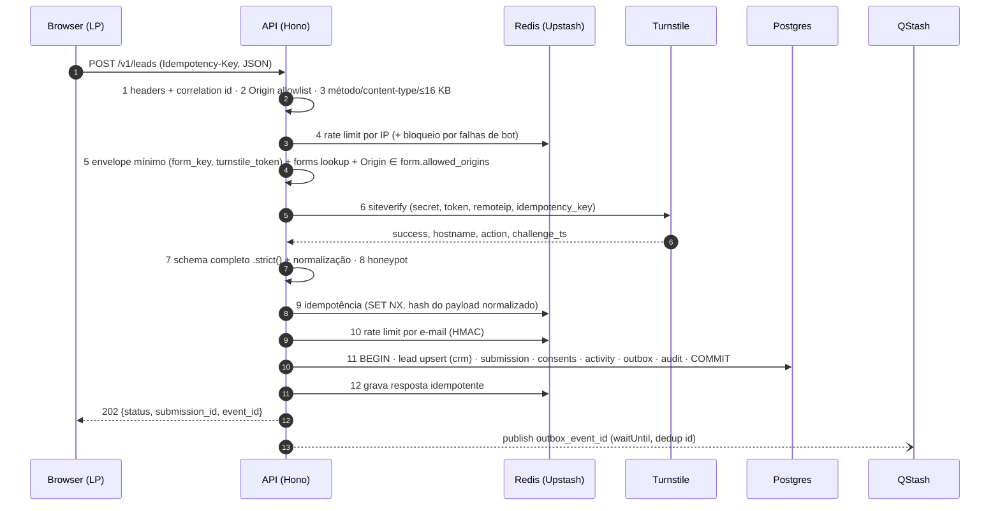

# Spec — Lead Capture (`POST /v1/leads`)

> Status: **draft v0.1** · Bounded context: `lead-capture` · Waves: 0, 2, 3, 4
> Contrato: [`contracts/openapi.v1.yaml`](../../contracts/openapi.v1.yaml) · ADRs: 0002, 0005
> Threat model: [backend-v1](../security/threats/backend-v1.md)

## 1. Objetivo

Receber a submissão do formulário da LP de forma segura (anti-bot, anti-abuso,
anti-injeção), validá-la e normalizá-la, registrar consentimentos e atribuição, e
entregar o lead ao CRM — atomicamente — respondendo `202` em ≤ 800 ms p95.

## 2. Fluxo do request (ordem fixa)



Justificativas da ordem:
- O Turnstile é a "autenticação" deste endpoint público (prova humana). Ele vem **antes**
  da validação completa, então só humanos recebem erros por campo.
- O token Turnstile é de **uso único** e é consumido em qualquer resposta ≥ 400 após o
  passo 6 → o front **sempre** chama `turnstile.reset()` após erro.
- Retentativa segura: o front reenvia com o **mesmo** `Idempotency-Key` e payload, mas com
  **novo** token Turnstile. O hash do payload exclui `turnstile_token`, então o passo 9
  devolve a resposta original (replay) sem duplicar o lead.

## 3. Contrato HTTP (resumo — fonte da verdade é o OpenAPI)

`POST https://api.<dominio>/v1/leads` · `security: []` (exceção pública, ADR-0005)

Headers de request:

| Header | Obrigatório | Regra |
|---|---|---|
| `Content-Type` | sim | `application/json` (charset utf-8 opcional), senão `415` |
| `Origin` | sim | Deve estar em `CORS_ALLOWED_ORIGINS` **e** em `form.allowed_origins`, senão `403 origin_not_allowed` |
| `Idempotency-Key` | sim | UUID (v4 ou v7). Gerado pelo front por *intenção de envio*; reutilizado em retentativas |
| `X-Request-Id` | não | UUID; se ausente/inválido o servidor gera. Sempre ecoado na resposta |

Corpo (JSON, máx. 16 KB, campos desconhecidos são rejeitados):

```json
{
  "form_key": "frm_lp_principal",
  "turnstile_token": "0.AbCd…",
  "first_name": "Maria",
  "last_name": "Silva",
  "email": "maria@empresa.com.br",
  "whatsapp": "+55 11 91234-5678",
  "company": "Empresa Ltda",
  "area_of_expertise": "technology",
  "area_of_expertise_other": null,
  "job_title": "Head de Marketing",
  "company_size": "11_50",
  "company_website": "https://empresa.com.br",
  "message": "Quero integrar o CRM com nossas campanhas.",
  "marketing_opt_in": true,
  "privacy_consent": true,
  "hp": "",
  "consent": {
    "analytics_storage": "granted",
    "ad_storage": "granted",
    "ad_user_data": "granted",
    "ad_personalization": "denied"
  },
  "tracking": {
    "event_id": "0f8c2c1e-7d0b-4b8e-9a51-2f3c4d5e6f70",
    "utm_source": "meta", "utm_medium": "cpc", "utm_campaign": "lp-crm-q4",
    "utm_term": null, "utm_content": "video-a", "utm_id": null,
    "gclid": null, "gbraid": null, "wbraid": null,
    "fbclid": "IwAR…", "fbp": "fb.1.1730600000000.123456789", "fbc": "fb.1.1730600000000.IwAR…",
    "ttclid": null, "msclkid": null, "ga_client_id": "123456789.1730600000",
    "landing_page_url": "https://www.dominio.com.br/?utm_source=meta",
    "referrer_url": "https://l.facebook.com/"
  }
}
```

Respostas:

| Status | `code` | Quando |
|---|---|---|
| `202` | — | Aceito (novo lead, lead existente ou honeypot — respostas **idênticas** em forma) |
| `400` | `invalid_json`, `validation_failed`, `idempotency_key_missing` | Corpo malformado, regras de campo, header ausente/inválido |
| `403` | `origin_not_allowed`, `bot_verification_failed` | Origin fora da allowlist; Turnstile inválido/expirado/reusado/hostname/action divergente |
| `404` | `form_not_found` | `form_key` inexistente, pausado ou arquivado |
| `409` | `idempotency_in_progress` | Mesma chave ainda processando (`Retry-After: 1`) |
| `413` | `payload_too_large` | > 16 KB |
| `415` | `unsupported_media_type` | Content-Type ≠ JSON |
| `422` | `idempotency_key_reused` | Mesma chave com payload diferente |
| `429` | `rate_limited` | Limite por IP/e-mail/formulário (`Retry-After` obrigatório) |
| `500` | `internal_error` | Falha inesperada (mensagem genérica + `correlation_id`) |
| `503` | `bot_verification_unavailable`, `service_unavailable` | Turnstile ou banco indisponíveis (`Retry-After`) |

Corpo `202`: `{ "status": "received", "submission_id": "<uuid>", "event_id": "<uuid>" }`.
Corpo de erro (RFC 9457):

```json
{
  "type": "https://api.<dominio>/problems/validation_failed",
  "title": "Validation failed",
  "status": 400,
  "code": "validation_failed",
  "correlation_id": "6a0b…",
  "errors": [ { "field": "whatsapp", "code": "invalid_format" } ]
}
```

Códigos por campo (estáveis; o front traduz para pt-BR): `required`, `too_short`,
`too_long`, `invalid_format`, `invalid_choice`, `not_allowed_characters`, `must_be_true`.
O servidor **nunca** devolve o valor recebido nem a regex usada.

## 4. Campos e regras de validação

Pipeline aplicado a **todo** campo string, antes das regras específicas:

1. Tipo estrito (string; número/array/objeto → `invalid_format`). `null` só onde o contrato permite.
2. `trim()` + normalização Unicode **NFC** + colapso de espaços internos (exceto `message`).
3. Rejeição de caracteres perigosos/invisíveis → `not_allowed_characters`:
   controle `\p{Cc}` (exceto `\n` em `message`), formato `\p{Cf}` (inclui zero-width
   `U+200B–U+200D`, `U+FEFF` e bidi overrides `U+202A–U+202E`, `U+2066–U+2069` —
   mitigação *Trojan Source*/spoofing na UI do CRM), surrogates soltos, `U+FFFD`.
4. Limite de comprimento medido **após** normalização, em code points.
5. Regra positiva (whitelist) do campo. Nada de blacklist de palavras SQL — a defesa
   contra SQLi é estrutural (seção 4.4), não filtragem de texto.

### 4.1 Tabela de campos

| Campo JSON | Label (pt-BR) | Obrig. | Limites | Normalização | Regra (whitelist) |
|---|---|---|---|---|---|
| `first_name` | Primeiro nome | **sim** | 1–60 | pipeline | `^[\p{L}\p{M}](?:[\p{L}\p{M}' .-]*[\p{L}\p{M}.])?$` (letras com acento, espaço, `'`, `-`, `.`; sem dígitos, `<>`, `@`, `;`, `"`) |
| `last_name` | Sobrenome | **sim** | 1–80 | pipeline | mesma regra de `first_name` |
| `email` | E-mail | **sim** | ≤ 254 (local ≤ 64) | pipeline + `toLowerCase()` | `z.email()` (ASCII, sem local-part entre aspas, sem IP literal, TLD ≥ 2); domínio em lista de descartáveis → `invalid_choice` (Q3) |
| `whatsapp` | WhatsApp | **sim** | entrada ≤ 32 | remove tudo exceto dígitos e `+` inicial; sem `+` assume `BR` | `libphonenumber-js` `isValid()` e tipo `MOBILE` ou `FIXED_LINE_OR_MOBILE`; armazenado em **E.164** (`^\+[1-9]\d{7,14}$`). BR: DDD válido + 9 dígitos começando em 9 |
| `company` | Empresa | **sim** | 2–120 | pipeline | `^[\p{L}\p{M}\p{N}](?:[\p{L}\p{M}\p{N} .,&'()/+-]*[\p{L}\p{M}\p{N}.)])?$` |
| `area_of_expertise` | Área de atuação | **sim** | enum | — | um dos códigos de §4.2 → senão `invalid_choice` |
| `area_of_expertise_other` | Qual área? | se `area_of_expertise = other` | 2–80 | pipeline | regra de `company`; **proibido** (`invalid_format`) se área ≠ `other` |
| `job_title` | Cargo | não | 2–100 | pipeline | regra de `company` |
| `company_size` | Nº de funcionários | não | enum | — | `solo`, `2_10`, `11_50`, `51_200`, `201_1000`, `1000_plus` |
| `company_website` | Site da empresa | não | ≤ 200 | pipeline; host em minúsculas; sem `https://` → prefixa | `URL` válida, esquema `http`/`https`, sem credenciais (`user@`), sem porta não padrão, host com TLD (não IP literal, não `localhost`, não `.local`/`.internal`). **Nunca buscado server-side em v1** (sem SSRF) |
| `message` | Qual seu principal desafio? | não | ≤ 1000 | NFC, `\r\n`→`\n`, máx. 10 quebras consecutivas | texto livre (pipeline passo 3). Tratado como **não confiável** em UI (escape) e em LLM (wave 11) |
| `marketing_opt_in` | Aceito receber conteúdos e ofertas | não (default `false`) | boolean | — | boolean estrito |
| `privacy_consent` | Li e aceito a Política de Privacidade | **sim** | `true` | — | literal `true` → senão `must_be_true` |

Campos técnicos (preenchidos pelo front, invisíveis ao usuário):

| Campo | Regra |
|---|---|
| `form_key` | `^frm_[a-z0-9_]{3,40}$`; deve existir em `core.forms` com `status = 'active'` |
| `turnstile_token` | string 1–2048 (limite documentado pela Cloudflare) |
| `hp` (honeypot) | string ≤ 200; **deve ser vazia**. No HTML: `name="fax"`, fora da tela via CSS, `tabindex="-1"`, `autocomplete="off"`, `aria-hidden="true"` |
| `consent.*` | cada chave ∈ {`granted`, `denied`}; objeto inteiro opcional (ausente = tudo `denied`) |
| `tracking.event_id` | UUID; se ausente/inválido o servidor gera (dedup Pixel×CAPI depende do front enviar) |
| `tracking.utm_*` | string ≤ 150, pipeline + `[\p{L}\p{N} ._\-+:/|]` |
| `tracking.gclid/gbraid/wbraid/fbclid/ttclid/msclkid` | string ≤ 500, `^[A-Za-z0-9._\-~]+$` |
| `tracking.fbp` / `tracking.fbc` | ≤ 500, `^fb\.[0-9]\.[0-9]{10,13}\.[A-Za-z0-9._\-]+$` |
| `tracking.ga_client_id` | ≤ 100, `^[0-9]+\.[0-9]+$` |
| `tracking.landing_page_url` / `referrer_url` | ≤ 2000, URL `https?`; host da landing deve pertencer a `form.allowed_origins` (senão é descartado, não rejeitado) |

### 4.2 Enum `area_of_expertise`

| Código | Label pt-BR |
|---|---|
| `marketing_advertising` | Marketing e Publicidade |
| `technology` | Tecnologia e Software |
| `ecommerce_retail` | E-commerce e Varejo |
| `infoproducts_creators` | Infoprodutos e Criadores de Conteúdo |
| `health` | Saúde |
| `education` | Educação |
| `finance` | Finanças, Bancos e Seguros |
| `real_estate` | Imobiliário |
| `industry` | Indústria |
| `professional_services` | Consultoria e Serviços Profissionais |
| `legal` | Jurídico |
| `agribusiness` | Agronegócio |
| `logistics` | Logística e Transporte |
| `food_hospitality` | Alimentação e Hotelaria |
| `construction` | Construção e Engenharia |
| `public_sector_nonprofit` | Setor Público e Terceiro Setor |
| `other` | Outro (exige `area_of_expertise_other`) |

### 4.3 Defesas por camada (aplicam-se a todos os campos)

| Camada | Controle |
|---|---|
| Browser (front) | Validação espelhada (UX apenas — **não é barreira**), `maxlength`, `inputmode`, `autocomplete` correto |
| Borda | CORS + Origin allowlist, Turnstile, rate limit, body ≤ 16 KB, Vercel Firewall (wave 6) |
| Aplicação | Zod `.strict()` (anti mass-assignment), pipeline Unicode, whitelist por campo, enums |
| Persistência | Queries parametrizadas, role `lp_api` sem DDL/DELETE, RLS, CHECK constraints espelhando limites e formatos (E.164, e-mail minúsculo, enums) |
| Saída | Escape automático no CRM (React), CSV com neutralização de fórmula (wave 9), logs com redaction |

### 4.4 Por que não há SQL Injection possível

1. **Nenhuma** string de usuário é concatenada em SQL: o repositório usa somente
   tagged templates do driver `postgres` (`sql\`… ${value}\``), que enviam valores como
   parâmetros do protocolo estendido. Identificadores (tabela/coluna) são constantes no código.
2. Lint bloqueante no CI: Semgrep proíbe `sql.unsafe(`, concatenação/template em strings
   passadas ao driver e `format(`/`EXECUTE` dinâmico em migrations.
3. A role `lp_api` não tem DDL, `DELETE`, `TRUNCATE`, nem acesso a `auth`, `storage` ou
   `public`; e não possui `BYPASSRLS`. Um SQLi hipotético ficaria confinado.
4. RLS por `workspace_id` + CHECK constraints rejeitam dado fora do formato mesmo se a
   validação da aplicação falhar.
5. Teste de regressão: payloads clássicos (`' OR 1=1--`, `'; DROP TABLE …`, `$$`, `\x00`,
   unicode homoglyphs) nos campos de texto livre são aceitos **como texto** (quando passam na
   whitelist) e persistidos literalmente, ou rejeitados com `not_allowed_characters` — nunca
   alteram a query (AC-LC-14).

## 5. Regras de negócio

- **R1 — Dedupe**: o lead é identificado por `(workspace_id, email)`. Nova submissão com
  e-mail existente **não** cria lead novo: cria nova `submission`, atualiza campos de
  contato não vazios (última submissão vence, exceto `first_touch`), incrementa
  `submissions_count`, registra atividade `submission_received`, recalcula score.
- **R2 — Anti-enumeração**: resposta para lead novo, lead existente e honeypot tem o
  mesmo status, formato e ordem de grandeza de latência (honeypot aguarda latência mediana
  simulada — sem `sleep` em teste: relógio injetado).
- **R3 — Honeypot**: `hp` não vazio → `202` com `submission_id` aleatório, nada persistido,
  métrica `lead_capture.requests{outcome="honeypot"}`.
- **R4 — Consentimentos**: cada submissão grava em `capture.consents` (append-only) as
  finalidades `privacy_policy` (sempre `true`), `marketing_communications`
  (`marketing_opt_in`) e `ad_tracking` (`consent.ad_user_data`), com `policy_version` do formulário.
- **R5 — Atribuição**: `first_touch` do lead é gravado só na criação; `last_touch` em toda
  submissão. Cada submissão guarda suas próprias UTMs/click IDs.
- **R6 — Outbox**: no mesmo commit, grava `tracking.outbox_events` `lead.captured`
  (payload = IDs, sem PII). Após o commit, publica no QStash; falha de publish não falha o request.
- **R7 — Idempotência**: chave por `(workspace_id, Idempotency-Key)` com TTL 24 h no Redis
  e `UNIQUE` em `capture.submissions` como segunda barreira. Hash = SHA-256 do payload
  **normalizado** sem `turnstile_token`.

## 6. Anti-abuso

| Controle | Regra |
|---|---|
| Rate limit IP | 5 req / 10 min (sliding) e 30 / 24 h por HMAC(IP). Excedido → `429` |
| Rate limit e-mail | 3 submissões / 1 h por HMAC(e-mail) |
| Rate limit formulário | 300 req / min por `form_key` (proteção de quota e alerta de flood) |
| Bloqueio por falha de bot | ≥ 10 falhas Turnstile / 10 min por IP → bloqueio de 1 h |
| Turnstile | `success = true`, `hostname` ∈ hosts de `form.allowed_origins`, `action = form.turnstile_action` (default `lead_submit`), `challenge_ts` ≤ 300 s, `idempotency_key` enviado ao siteverify |
| IP do cliente | `ipAddress()` de `@vercel/functions` (nunca `X-Forwarded-For` cru); a API **não** fica atrás do proxy laranja da Cloudflare (ADR-0002) |
| Ambientes | CI usa chaves de teste Turnstile (`1x0000000000000000000000000000000AA` passa, `2x…AA` falha, `3x…AA` = token já usado) |

## 7. Edge cases

| Caso | Comportamento |
|---|---|
| Duplo clique no botão | Mesma `Idempotency-Key` → 2º request recebe `409 idempotency_in_progress` ou replay do `202` |
| Rede cai após o servidor commitar | Front reenvia com mesma chave + novo token → replay do `202` original |
| Mesmo e-mail em 2 abas simultâneas (chaves diferentes) | `INSERT … ON CONFLICT (workspace_id, email) DO UPDATE` — 1 lead, 2 submissões |
| E-mail com maiúsculas / espaços | Normalizado para minúsculas; dedupe funciona |
| WhatsApp sem DDI (`11912345678`) | Assume BR → `+5511912345678` |
| WhatsApp estrangeiro (`+1 415…`) | Aceito se válido |
| Nome com acento/apóstrofo/hífen (`João D'Ávila-Souza`) | Aceito |
| Nome com emoji, dígito ou `<script>` | `not_allowed_characters` |
| `area_of_expertise = other` sem `area_of_expertise_other` | `required` em `area_of_expertise_other` |
| Campo extra no JSON (`"stage":"won"`) | `400 validation_failed` (`field: "stage"`, `code: "not_allowed"`) — anti mass-assignment |
| `consent` ausente | Tudo `denied`: lead salvo, **sem** CAPI/GA4 (só Pixel client-side se o banner permitir) |
| Turnstile token reusado | `403 bot_verification_failed` (front faz `reset()`) |
| Redis indisponível | Rate limit fail-open + log `warn` + métrica; idempotência cai para o `UNIQUE` do banco |
| Postgres indisponível | `503 service_unavailable` + `Retry-After: 5`; nada parcialmente gravado |
| Formulário pausado | `404 form_not_found` |
| Lead anonimizado (LGPD) re-submete | Cria **novo** lead (o anonimizado não participa do índice único) |

## 8. Mapeamento OWASP

| OWASP Top 10:2025 | Controle neste slice |
|---|---|
| A01 Broken Access Control | Endpoint só cria; não lê nem altera dados de terceiros. Workspace derivado do `form_key` server-side; RLS por workspace; nada de IDs do cliente usados para autorização |
| A02 Security Misconfiguration | Headers de segurança em todas as respostas, CORS allowlist sem `*`, sem credenciais CORS, erros genéricos, Data API do Supabase desligada para schemas do app |
| A03 Software Supply Chain Failures | Lockfile, versões pinadas, osv-scanner + Dependabot, Actions por SHA |
| A04 Cryptographic Failures | TLS (verify-full) até o Postgres, HMAC-SHA256 com pepper para IP/e-mail, SHA-256 normalizado só para envio a ads, nenhum segredo no front |
| A05 Injection | §4.4 (SQLi), pipeline Unicode, whitelist por campo, escape na saída, neutralização CSV, sem `eval`/template dinâmico |
| A06 Insecure Design | Threat model, anti-enumeração, idempotência, honeypot, limites de tamanho, rate limit em 3 dimensões |
| A07 Authentication Failures | Turnstile como prova humana obrigatória (endpoint público); validação de hostname/action/idade do token |
| A08 Software or Data Integrity Failures | Assinatura QStash verificada nos endpoints internos; outbox transacional; consentimentos append-only |
| A09 Security Logging & Alerting Failures | Logs estruturados sem PII, audit log, métricas e alertas de falha de bot/rate limit |
| A10 Mishandling of Exceptional Conditions | Fail-closed no Turnstile, fail-open documentado no rate limit, transação atômica, handler global de erros sem vazamento |

| OWASP API Top 10:2023 | Controle |
|---|---|
| API3 BOPLA (mass assignment) | `.strict()`; campos como `stage`, `score`, `owner` não existem no contrato público |
| API4 Unrestricted Resource Consumption | Body ≤ 16 KB, limites por campo, rate limits, `maxDuration` 10 s |
| API6 Unrestricted Access to Sensitive Business Flows | Turnstile + honeypot + limites por e-mail/formulário |
| API7 SSRF | `company_website` nunca é buscado em v1 |
| API8 Security Misconfiguration | Igual A02 |

## 9. Critérios de aceite

Formato Given/When/Then; cada um vira teste (unit, integração ou e2e indicado).

| ID | Critério | Nível |
|---|---|---|
| AC-LC-01 | Dado payload válido com Turnstile válido, quando POST, então `202` com `submission_id` e `event_id` UUID, e existem 1 lead, 1 submission, 3 consents, 1 activity, 1 outbox_event, 1 audit no banco | integração |
| AC-LC-02 | Dado cada um dos 6 campos obrigatórios ausente, então `400 validation_failed` com `errors[].field` = campo e `code = required` | unit |
| AC-LC-03 | Dado `privacy_consent = false`, então `400` com `must_be_true` | unit |
| AC-LC-04 | Dado e-mail existente, quando nova submissão válida, então o número de leads não muda, `submissions_count` incrementa e o corpo da resposta tem o mesmo formato do caso novo | integração |
| AC-LC-05 | Dado `hp` não vazio, então `202` e nenhuma linha é criada em nenhuma tabela | integração |
| AC-LC-06 | Dado token Turnstile inválido (chave de teste `2x…`), então `403 bot_verification_failed` e nenhuma validação de campo é executada | integração |
| AC-LC-07 | Dado Origin fora da allowlist, então `403 origin_not_allowed` e preflight sem `Access-Control-Allow-Origin` | integração |
| AC-LC-08 | Dado 6ª requisição do mesmo IP em 10 min, então `429` com `Retry-After` | integração (Redis fake) |
| AC-LC-09 | Dada mesma `Idempotency-Key` + mesmo payload (novo token), então a 2ª resposta é idêntica à 1ª e só existe 1 submission | integração |
| AC-LC-10 | Dada mesma `Idempotency-Key` + payload diferente, então `422 idempotency_key_reused` | integração |
| AC-LC-11 | Dado campo desconhecido no corpo, então `400` (`code: not_allowed`) | unit |
| AC-LC-12 | Dado corpo > 16 KB, então `413`; dado `Content-Type: text/plain`, então `415` | integração |
| AC-LC-13 | Para todo valor gerado por fast-check (strings Unicode arbitrárias), o validador nunca lança exceção, e todo valor aceito satisfaz os CHECK constraints do banco | unit (property-based) |
| AC-LC-14 | Payloads de SQLi/XSS em `message` são persistidos literalmente e lidos de volta byte a byte iguais; em `first_name` resultam em `not_allowed_characters` | integração |
| AC-LC-15 | `+55 (11) 91234-5678`, `11912345678` e `5511912345678` normalizam para `+5511912345678`; `1191234567` (8 dígitos sem 9) é rejeitado | unit |
| AC-LC-16 | Toda resposta (inclusive 4xx/5xx/preflight) contém os 8 headers de segurança de [000 §5.1](000-overview.md#51-segurança-baseline-transversal) | integração |
| AC-LC-17 | Nenhum log emitido durante a suíte contém e-mail, WhatsApp, nome, IP ou token (scanner sobre o output capturado) | integração |
| AC-LC-18 | Postgres fora → `503` sem stack trace; erro inesperado → `500 internal_error` com `correlation_id` | integração |
| AC-LC-19 | Em preview na Vercel, `k6` com 20 VUs por 1 min: p95 ≤ 800 ms e 0% de 5xx | e2e (wave 6) |

## 10. Handoff para o front (Codex — wave 7)

1. Formulário com os campos de §4.1 na ordem: primeiro nome, sobrenome, e-mail, WhatsApp,
   empresa, área de atuação (+ "qual?"), cargo, nº de funcionários, site, desafio,
   opt-in de marketing, aceite da política (link para a política versionada).
2. Validação client-side espelhando §4 (mensagens pt-BR por `code`), máscara de WhatsApp
   BR sem impedir número internacional.
3. Turnstile: widget managed, `action="lead_submit"`, `response-field` desligado (envia o
   token no JSON); após **qualquer** resposta ≥ 400, `turnstile.reset()`.
4. Gerar `Idempotency-Key` (`crypto.randomUUID()`) ao clicar enviar; reutilizar em
   retentativas da mesma intenção; gerar nova após `202` ou após o usuário editar o formulário.
5. Gerar `tracking.event_id` (`crypto.randomUUID()`) e usar o **mesmo** valor como
   `eventID` do `fbq('track','Lead',…)` e no push `generate_lead` do dataLayer
   (ver [tracking §3](tracking.md#3-contrato-do-datalayer)).
6. Ler `_fbp`, `_fbc`, `_ga` dos cookies e UTMs/click IDs da URL (persistidos em
   `sessionStorage` na primeira página vista) para preencher `tracking.*`.
7. Botão desabilitado durante o envio; `429`/`503` mostram "tente novamente em X s" usando `Retry-After`.
8. Nunca colocar PII no dataLayer, em query string ou em `localStorage`.
